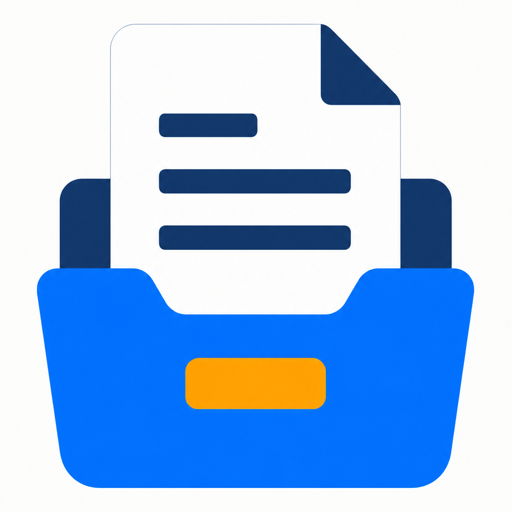
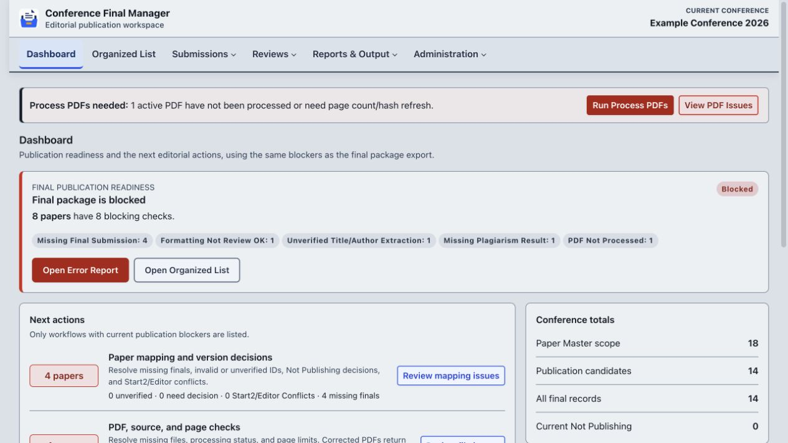
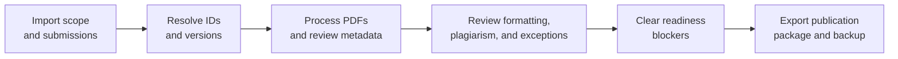
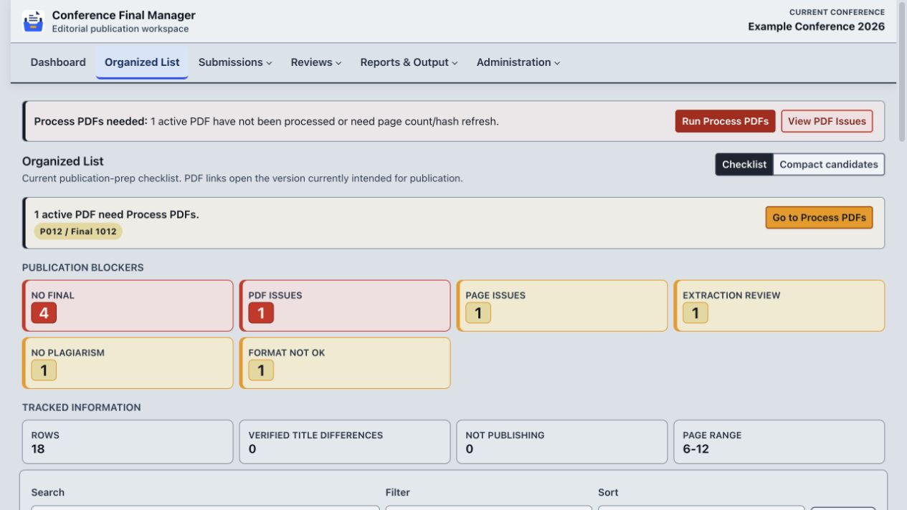

<p align="center">
  
</p>

<h1 align="center">Conference Final Manager</h1>

<p align="center">
  A local-first editorial workspace for turning conference final submissions
  into a verified, auditable publication package.
</p>

<p align="center">
  <strong>Django + SQLite</strong> ·
  <strong>Runs locally</strong> ·
  <strong>Fail-closed publication checks</strong> ·
  <strong>Portable backups</strong>
</p>

<p align="center">
  <a href="#quick-start">Quick start</a> ·
  <a href="#editorial-workflow">Workflow</a> ·
  <a href="docs/operator_guide.md">Operator guide</a> ·
  <a href="docs/README.md">All documentation</a>
</p>



> The preview uses a disposable example conference. No production conference
> data is included in the repository.

## What It Does

Conference Final Manager keeps the complete proceedings-preparation workflow in
one local application:

- imports the Paper Master scope and Final Submission metadata;
- tracks Start2 versions, Editor Uploads, corrected files, and publication
  exclusions;
- retains immutable Formatting revision PDF/source pairs for viewing and
  download, including through System State backup/restore;
- compares saved Original/revision PDFs with the selected publication PDF using
  rendered-page RapidOCR and bounded small-edit alignment. Annotated documents
  show text changes, unlocated ranges and inspectable visual-tolerance information;
  a top-docked inspection area shows complete crops without internal scrolling
  and follows the pointer using the same selected region pair as its connection
  line, or relative positions when no pair exists. Candidate links remain
  explicitly unverified. Selected evidence stays readable independently.
  Retina-aware crops sharpen on a brief pointer pause from the same verified PDF
  snapshot, independently of OCR and comparison evidence.
  Linked pages without a counterpart show an explicit empty state, not an unrelated PDF page.
  Headers/footers, formulas and image text remain in scope. A saved Formatting
  PDF upload automatically starts a separate Original comparison;
- keeps automatic comparison status with its own paper card; an upload that
  leaves the current filter has a one-return receipt, not a panel carried into
  unrelated searches or tabs. Re-entered panels revalidate the saved revision;
- processes PDFs and coordinates Paper ID, title/author, formatting,
  plagiarism, author-count, and exception reviews;
- gives Dashboard, Organized List, Error Report, and final export one shared
  definition of publication readiness;
- exports editorial workbooks, CrossCheck packages, and the final publication
  package;
- optionally sends previewed publication PDFs to a local CrossCheck Service,
  tracks batches and retry-download executions, and previews version-bound
  scores/reports before applying; retries never upload PDFs or replay applied results;
- records state-changing work in an audit log and creates portable System State
  backups.

The PDF comparison shows engine coverage status, limitation reasons,
evidence counts and unlocated ranges; see the
[comparison contract](docs/pdf_comparison.md).
Local CPU comparisons reuse signed evidence only for identical PDF bytes and
the same validated runtime. Repeated comparisons and unchanged originals can
avoid repeated OCR; first-time work can still time out. Cache reuse never skips
current-file or upload-revision checks. Native startup defaults to embedded CPU
execution. Docker can use a host-shared comparison worker, with an optional
preferred remote CPU/GPU worker. With a remote configured, new local CPU work
requires explicit confirmation instead of a silent fallback, but validated complete
cache results are reused directly without starting computation. Formatting shows
both services' status every ten seconds while visible, and comparisons label
their recorded worker/backend. See the
[compute service contract](docs/pdf_comparison.md#shared-comparison-service) and
[Docker setup](docs/docker_guide.md). Workers never select publication files or
access conference databases.
Remote workers behind Cloudflare Access or another HTTP gateway can use
per-conference custom authentication headers from the same private `.env` file;
see [Remote Gateway Authentication](docs/docker_guide.md#remote-gateway-authentication).
These headers supplement the worker token and never go to the local CPU worker.
Worker requests identify CFM with a shared application User-Agent; gateway
errors retain safe HTTP/Cloudflare codes instead of suggesting every rejection
is a bad token.
Worker Compose settings support independent Small/Medium detection and
recognition models, bounded concurrent pages and a configurable OCR timeout.
Standalone workers default to CPU two pages and GPU four pages, with four
threads per page, Small/Small and 300 seconds. Native/embedded CPU stays at one
page. Explicit existing page/thread settings are preserved. GPU uses exact CTC
reduction; both workers use bounded dynamic dispatch at unchanged 300 DPI and
batch 6. Update CFM and workers together for the shared compute contract. See
[Worker OCR Settings](docs/docker_guide.md#worker-ocr-settings) before tuning memory
or switching models. A worker invalidates completed cache from its previous
model/runtime; existing cross-worker cache discovery may still reuse valid
evidence from another unchanged worker, with its actual worker attribution.
Standalone GPU workers retain one supervised model process between jobs and
unload it after 30 minutes without inference. Set `CFM_GPU_MODEL_IDLE_SECONDS`
in the **worker** env (0 disables residency; 1-86400 seconds). CPU is unchanged.
Health checks and complete cache hits do not keep models loaded or reload an
idle model. Formatting service Details distinguishes loaded/unloaded/loading
models from service availability. The model process shares weights, not
conference settings or signed caches; job timeouts/crashes discard it.
Authenticated worker health also reports its packaged release version and
allowlisted effective settings from successful runtime validation. Formatting's
Comparison services shows each release alongside backend/status; Details lists
models, concurrent pages, threads, OCR timeout and model idle unload. No secrets
or paths are exposed. Unreachable workers show last-seen metadata explicitly;
older workers without metadata remain unavailable, not guessed. Release numbers
are informational: the existing compute contract still determines compatibility.
Method 8's broad visual policy can deliberately tolerate real similar-character
edits such as O/0, f/t, rn/m and same-letter diacritics (e/é/è); whitespace-only changes can also be missed.
Engine completion or zero findings is not publication approval. Figures, image
preservation, tables, layout and full mathematical structure require manual review.

Automatic CrossCheck has no prefilled service address. In Settings, enter the
URL and any required service login before testing the connection. Optional
credentials can be saved for that URL without enabling the integration or
saving the rest of Settings; existing configured addresses are preserved.

PDF open links share a local, read-only, full-window PDF.js reader with page
navigation, zoom, text selection/search and rotation. A compact toolbar replaces
the site's navigation and footer only on the reader page. It opens in Fit page
and Single page mode, with an optional Continuous scrolling switch.
In Single page mode, the wheel turns pages; zoomed pages scroll internally first,
then require a fresh wheel gesture at the edge. Trackpad inertia cannot skip pages.
Keyboard navigation shares the same boundary handling: Left/Right change pages,
Up/Down and Page Up/Down pan first, and Home/End jump to the first/last page.
Shortcuts apply in the PDF area, not in inputs or toolbar controls.
The collapsible left thumbnail sidebar lists every page, scrolls independently,
and follows the current page. Thumbnails are drawn lazily from the same loaded PDF.
Downloads and publication selection
remain on their existing endpoints; Open directly is available as a native
browser fallback. See the [Operator Guide](docs/operator_guide.md#pdf-reader).

The application is designed for editors working on a trusted local machine. It
has no login system, cloud database, or hardened public deployment mode.

## Editorial Workflow



The system deliberately fails closed: unresolved version ambiguity, missing or
changed publication files, stale review evidence, and other structural
conflicts block the final package instead of being guessed around.

<details>
<summary><strong>See the publication checklist view</strong></summary>



</details>

## Quick Start

Choose native startup or Docker deployment; they are separate installation paths.

### Native Startup

Python 3.12 or newer is required. The first run needs internet access to install
Python packages; normal local operation is offline afterward. PDF comparison
also requires checksum-verified local OCR models before startup. The unified
Docker deployer downloads missing pinned models automatically during setup;
comparison requests and native launchers never download models.
Startup fails before migrations if its
comparison runtime is unavailable. See [PDF comparison setup](docs/developer_guide.md#pdf-comparison-runtime)
and [Docker setup](docs/docker_guide.md#pdf-comparison-runtime).

macOS or Linux:

```bash
./scripts/start_local.sh
```

On macOS, you can also open `start.command` from Finder.

Windows:

```text
start_windows.bat
```

Open <http://127.0.0.1:8000/>. The startup scripts create `.venv`, install
requirements, validate dependencies and the comparison runtime, then apply
migrations and prepare local data folders. A broken or older-Python virtual
environment produces recovery instructions without deleting conference data.

### Docker

Docker is optional and intended for trusted local or LAN operation:

Use the unified deployment entry point described in the
[Docker Guide](docs/docker_guide.md). It prepares missing models, private client
tokens and the shared CPU worker before creating the conference. Existing
configuration and data are preserved; invalid/conflicting settings are rejected.

```bash
python3 scripts/deploy.py conference --name conference-a --port 8000 --dry-run
python3 scripts/deploy.py conference --name conference-a --port 8000
```

Use a unique `COMPOSE_PROJECT_NAME`, port, and data mirror for every conference.
See the [Docker Guide](docs/docker_guide.md) before updating, backing up,
migrating, or recovering a Docker instance.
Normal updates use `python3 scripts/update_docker_instances.py --dry-run`, then
the same command without `--dry-run`; it prepares local compute prerequisites
and updates the selected conferences. `deploy.py update` is an equivalent
entry point, not a second deployment workflow.
Standalone worker first setup requires `deploy.py worker --init` (optionally
`--template <file>` for custom initial settings). Without `--init`, worker
commands update only: the selected/default `runtime/comparison-slave/worker.env`
and existing private clients must exist. Missing identity/authorization is a
read-only error, not permission to invent names or tokens. First conference
creation can prepare a genuinely new local CPU worker; an existing conference
update cannot. Historical worker/rebuild CLI names use these same guards.
Remote GPU setup and one-time private enrollment are covered in
[Unified Deployment](docs/docker_guide.md#unified-deployment). Measured full-PDF
GPU Docker timings and known network/CPU limits live in
[Deployment Validation](docs/deployment_validation.md), not the installation steps.

## Publication Safety

The most important rules are:

- Paper Master defines publication scope.
- Each Paper Master record owns its Publishing / Not Publishing decision, even
  before a Final Submission exists.
- Creating or importing a Master ID that matches an orphan Final with a prior
  Not Publishing decision enters Decision Required; it never silently returns
  that Final to publication scope.
- Editor Upload outranks Start2, but mixed undiscarded sources block final
  export.
- Corrected files outrank Original files; a selected Corrected file that is
  missing never silently falls back.
- Paper Master and Final Submission imports are separate preview-before-apply
  workflows. Re-importing a Final preserves its Official Paper ID unless the
  Author-entered ID changed or the existing Official ID is blank.
- Existing Paper Master and Final Submission record edits also require a
  server-validated change preview. Only genuinely different values/files are
  applied, and every resulting review reset is shown before confirmation.
- Dashboard and final export use the same readiness findings.
- Review state resets only when its documented evidence changes.
- State-changing workflows and exports are audited.
- Editorial Excel exports are read-only, atomically generated snapshots; text
  that resembles a spreadsheet formula is preserved as non-executable text.

[Publication Rules](docs/publication_rules.md) is the canonical specification.
Do not select publication input by browsing or copying files from `data/`.

## Documentation

| If you want to… | Read |
| --- | --- |
| Understand the documentation set | [Documentation Home](docs/README.md) |
| Run the conference workflow | [Operator Guide](docs/operator_guide.md) |
| Diagnose an error or unexpected result | [Troubleshooting](docs/troubleshooting.md) |
| Install, update, back up, or recover Docker | [Docker Guide](docs/docker_guide.md) |
| Review actual GPU Docker timings and tested deployment limits | [Deployment Validation](docs/deployment_validation.md) |
| Understand publication scope, versions, files, and export rules | [Publication Rules](docs/publication_rules.md) |
| Develop or review code changes | [Developer Guide](docs/developer_guide.md) |
| Understand service boundaries and safety design | [Architecture Notes](docs/architecture.md) |
| Change shared UI or worklist behavior | [UI Conventions](docs/ui_conventions.md) |
| Validate a release before a real handoff | [Editorial Acceptance Runbook](docs/editorial_acceptance_runbook.md) |
| Review user-visible history | [Changelog](CHANGELOG.md) |

## Restoring An Existing Conference

On the new or restored machine:

1. Start the application.
2. Open `/integrations/system-state/`.
3. Upload the System State ZIP.
4. Review the preview.
5. Apply only when the preview matches the intended conference.

System State restores settings, records, managed files, reports, review
artifacts, and audit logs while remapping managed paths to the receiving
installation. Archived record timestamps are preserved; restoring a backup
does not renew an expired CrossCheck upload preview.

Version 1.14.0 adds Formatting revision history. After upgrading, run
`python manage.py migrate` and `python manage.py backfill_formatting_revisions`
with the application's Python environment. The idempotent capture command
preserves current corrected files, including inactive/discarded submissions,
without changing review state. It cannot reconstruct earlier revisions.
New backups use State archive v8, including automatic CrossCheck batches,
per-execution ZIPs and per-paper result history. Validated v5/v6/v7 backups
remain restorable; v7 jobs are captured as their original execution without
changing publication files or review state. Earlier archives have no
automatic job history, and v5 has no revision records. Optional service secrets
stay on the receiving machine and are excluded from System State ZIPs. See the
[Operator Guide](docs/operator_guide.md#plagiarism-crosscheck-workflow).

## Development

Manual setup:

```bash
python3 -m venv .venv
source .venv/bin/activate
python -m pip install --upgrade pip
python -m pip install -r requirements.txt
# Provision the approved OCR models as described in the Developer Guide first.
python scripts/check_comparison_runtime.py
python manage.py migrate
python manage.py runserver 127.0.0.1:8000
```

Before changing workflow, storage, export, review, or publication behavior,
read the [Developer Guide](docs/developer_guide.md). It contains the required
regression gate, code ownership map, version rules, and release checklist.

Import templates are available inside the application and under
[`sample_data/`](sample_data/).
